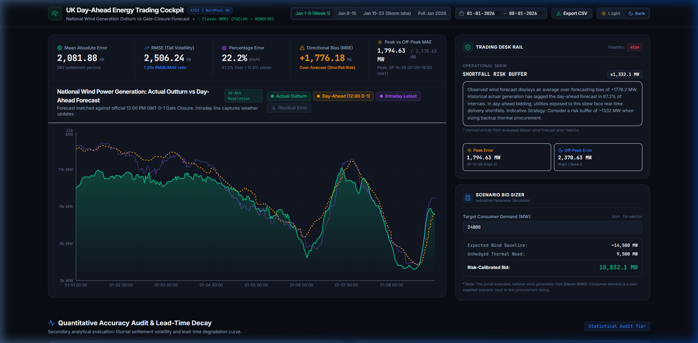
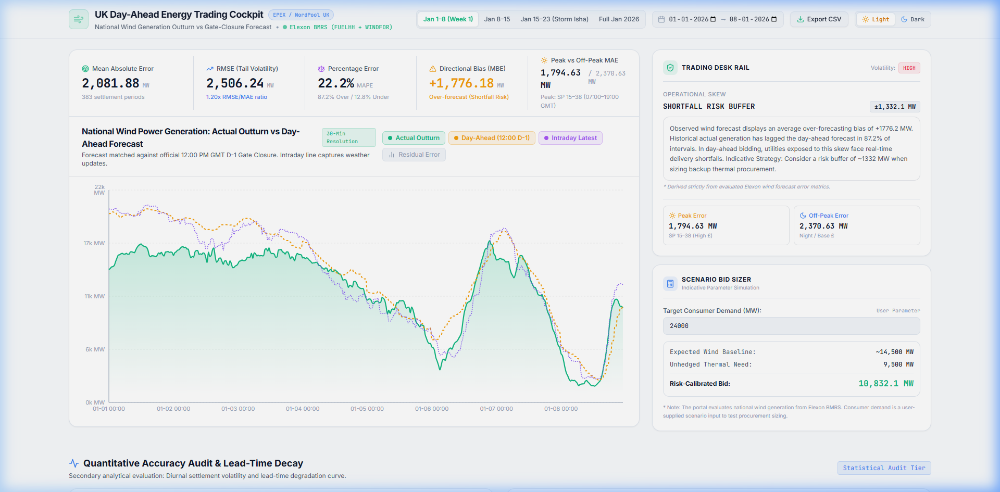
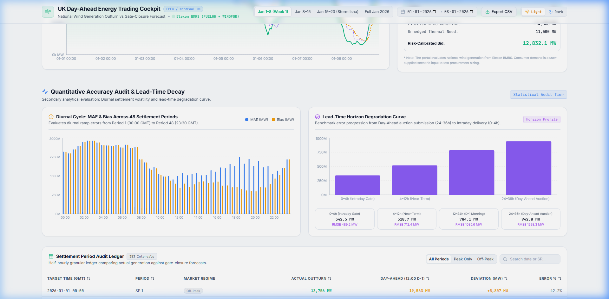
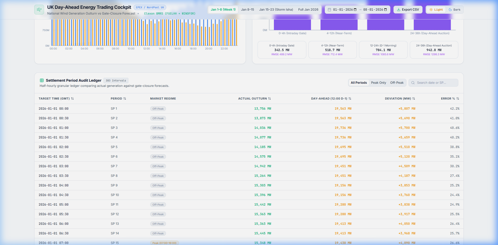

# ⚡ UK Energy Utility Wind Power Forecast & Accuracy Evaluation Portal

<div align="center">


-10B981?style=for-the-badge&logo=pytest&logoColor=white)

**An institutional-grade Day-Ahead renewable forecasting, accuracy evaluation, and risk-hedging cockpit built for UK power utilities trading on EPEX SPOT and Nord Pool UK.**

[Overview](#-executive-summary--market-problem) • [Visual Showcase](#-visual-showcase) • [Key Features](#-core-capabilities) • [Architecture](#-system-architecture) • [Math & Formulations](#-mathematical-error-metrics) • [API Reference](#-api-endpoints) • [Quick Start](#-quick-start-guide) • [Testing](#-automated-testing--verification)

</div>

---

## 📌 Executive Summary & Market Problem

In Great Britain's wholesale electricity market, commercial utilities must purchase power one day prior to physical delivery at the **Day-Ahead Auction gate closure (12:00 PM GMT on Day D-1)**. 

Because national wind power output is weather-dependent and volatile, power suppliers face punitive financial imbalance charges in Elexon's real-time **Balancing Mechanism (BM)** whenever actual wind generation diverges from their forward contracted positions:

| Forecast Direction | Physical Grid Impact | Commercial & Balancing Cashout Exposure |
| :--- | :--- | :--- |
| **Over-forecast** ($F > A$) | Wind outturn falls short of projection | **Shortfall Risk:** Utility must purchase emergency deficit volume at punitive **System Buy Prices (SBP)**. |
| **Under-forecast** ($F < A$) | Wind outturn exceeds projection | **Surplus Risk:** Utility must dump uncontracted excess energy at depressed or negative **System Sell Prices (SSP)**. |

This application gives utility power traders, quantitative analysts, and dispatch operators an institutional software platform to ingest raw settlement streams from Elexon BMRS (`FUELHH` and `WINDFOR`), enforce the strict 12:00 D-1 auction gate closure rule, audit statistical error metrics, analyze 48-period diurnal ramp risk, and calibrate day-ahead procurement bids.

---

## 📸 Visual Showcase

### Deep Obsidian Dark Mode Cockpit (Fluid 1720px Widescreen)
> *Asymmetric 70/30 layout featuring the Hero Forecast Time-Series, Integrated Metric Ribbon, Operational Skew Card, and Scenario Bid Sizer.*



---

### Crisp Porcelain Light Mode Cockpit
> *Engineered with HSL-tailored tokens, accessible contrast ratios, and a segmented Light/Dark theme controller.*



---

### Quantitative Accuracy Audit & Diurnal Cycles
> *Diurnal cycle analysis across 48 half-hour settlement periods (00:00–23:30 GMT) alongside lead-time horizon decay benchmarks (0h–36h).*



---

### Interactive Settlement Period Audit Ledger
> *Granular settlement period ledger with real-time text search, Peak / Off-Peak regime filtering, multi-column sorting, and pagination.*



---

## ⚡ Core Capabilities

### 1. Asymmetric 70/30 Trading Cockpit (1720px Fluid Canvas)
* **Widescreen Fluid Layout:** Replaces cramped standard cards with an expansive `max-w-[1720px]` canvas designed for multi-monitor trading desks.
* **Integrated Metric Ribbon:** Displays **MAE**, **RMSE**, **MAPE**, **Mean Directional Bias (MBE)**, and **Peak vs Off-Peak MAE** directly above the primary chart canvas.
* **Residual Error Overlays:** One-click toggleable error bars illustrating interval-by-interval shortfall (over-forecast) and surplus (under-forecast) volumes in MW.

### 2. Strict Day-Ahead Gate Closure Enforcement (12:00 PM GMT D-1)
* **Zero Look-Ahead Leakage:** For each half-hour delivery interval, only forecasts published strictly on or before 12:00 PM GMT on the previous day ($D-1$) are matched as the Day-Ahead position.
* **Intraday Latest Comparison:** Concurrently tracks the latest available forecast published prior to physical delivery to measure intra-day weather updates and model convergence.

### 3. Dual Institutional Themes with Segmented Switcher
* **Deep Obsidian Dark (`#0A0D14`):** Tailored for dark trading room environments with low eye-strain surfaces (`#111622`) and glowing emerald/amber data strokes.
* **Crisp Porcelain Light (`#F8FAFC`):** Engineered with crisp `#FFFFFF` card surfaces, subtle borders, and accessible typography.
* **Segmented Pill Controller:** Explicit `[ ☀️ Light ] [ 🌙 Dark ]` segmented toggle with zero visual ambiguity, pre-hydration persistence in `localStorage`, and zero flash of unstyled content (FOUC).

### 4. Interactive Settlement Interval Audit Ledger
* **Search & Filter:** Instant live filtering by settlement date, clock time, or settlement period (e.g., `SP 20`).
* **Regime Switching:** Quick filter between **All Periods**, **Peak Only** (SP 15–38 / 07:00–19:00 GMT), and **Off-Peak**.
* **Column Sorting & Pagination:** Sort by Target Time, Period, Actual Outturn, Forecast MW, Deviation Magnitude, or Percentage Error.

### 5. Decision Support & Scenario Bid Sizer
* **Operational Skew Guidance:** Automatically detects whether the market regime requires a **Shortfall Risk Buffer**, a **Surplus Spill Risk Hedge**, or a **Neutral Uncertainty Hedge**.
* **Interactive Scenario Sizing:** Allows the trader to input a custom utility consumer demand parameter (e.g. 24,000 MW) to dynamically calculate unhedged thermal requirements and risk-calibrated day-ahead power bids.
* **Intellectual Honesty:** All scenario parameters are explicitly labeled as user-supplied inputs, distinguishing them from verified historical Elexon outturns.

---

## 🏛️ System Architecture

```text
┌─────────────────────────────────────────────────────────────────────────────────┐
│                           REACT 18 VITE FRONTEND                                │
│   - Fluid 1720px Canvas (Tailwind CSS + CSS Variables)                         │
│   - Segmented Dark/Light Theme Switcher (Persistent localStorage)               │
│   - Interactive Time-Series (Recharts Area, Line, Bar, & Gradient Visualizers) │
│   - Settlement Interval Audit Ledger (Filter, Search, Sort, Paginate)           │
│   - Scenario Bid Sizing Calculator & Operational Guidance Card                 │
└───────────────────────────────────────▲─────────────────────────────────────────┘
                                        │ HTTP REST (JSON)
┌───────────────────────────────────────▼─────────────────────────────────────────┐
│                           FASTAPI PYTHON BACKEND                                │
│   - Async Router (/api/dashboard, /api/timeseries, /api/metrics, /api/health)   │
│   - Gate Closure Matcher: Filters publishTime <= 12:00 PM GMT on Day D-1       │
│   - Vectorized Math Engine: MAE, RMSE, MAPE, MBE, Peak/Off-Peak via NumPy       │
│   - Master Cache Slicing Engine: Slices sub-ranges from master month in < 1ms   │
└───────────────────────────────────────▲─────────────────────────────────────────┘
                                        │ Async HTTPX Streaming
┌───────────────────────────────────────▼─────────────────────────────────────────┐
│                       PUBLIC ELEXON BMRS DATA SERVICE                           │
│   - FUELHH Stream : Half-hourly wind generation outturn (fuelType = "WIND")     │
│   - WINDFOR Stream: National wind power forecasts published prior to delivery   │
└─────────────────────────────────────────────────────────────────────────────────┘
```

---

## 🧮 Mathematical Error Metrics

For $N$ half-hour settlement periods with actual wind outturn $A_i$ and Day-Ahead forecast $F_i$:

### 1. Mean Absolute Error (MAE)
$$\text{MAE} = \frac{1}{N} \sum_{i=1}^{N} |F_i - A_i|$$
*Quantifies the average unhedged volume exposure (in MW) that the utility must balance in real time.*

### 2. Root Mean Square Error (RMSE)
$$\text{RMSE} = \sqrt{\frac{1}{N} \sum_{i=1}^{N} (F_i - A_i)^2}$$
*Heavily penalizes large forecasting misses, sudden weather front shifts, and severe wind ramps that trigger extreme balancing cashout spikes.*

### 3. Mean Absolute Percentage Error (MAPE)
$$\text{MAPE} = \frac{100\%}{M} \sum_{i \in \{i \mid A_i > 50\}} \frac{|F_i - A_i|}{A_i}$$
*Safely computed by filtering near-zero baselines ($A_i > 50\text{ MW}$) to prevent artificial division-by-zero blowups.*

### 4. Mean Directional Bias Error (MBE)
$$\text{MBE} = \frac{1}{N} \sum_{i=1}^{N} (F_i - A_i)$$
* **$\text{MBE} > 0$ (Over-forecast):** Wind generation underperformed expectations $\rightarrow$ Shortfall Risk (punitive System Buy Price cashout).
* **$\text{MBE} < 0$ (Under-forecast):** Wind generation exceeded expectations $\rightarrow$ Surplus Risk (depressed System Sell Price cashout).

### 5. Day-Ahead Gate Closure Matching Condition
$$\text{Forecast}_{\text{DA}}(t) = \max_{\text{publishTime} \le \text{GateClosure}(t)} \left( \text{WINDFOR}(t, \text{publishTime}) \right)$$
$$\text{where } \text{GateClosure}(t) = \text{Date}(t) - 1\text{ day at 12:00:00 UTC}$$

---

## 📡 API Endpoints

The backend is built with FastAPI and provides auto-generated OpenAPI / Swagger docs at `/docs`:

| Method | Endpoint | Query Parameters | Description |
| :--- | :--- | :--- | :--- |
| `GET` | `/api/health` | — | Health check, service status, and market context |
| `GET` | `/api/dashboard` | `start_date`, `end_date` | Complete analytical bundle (timeseries, metrics, hourly, horizons, decision) |
| `GET` | `/api/timeseries`| `start_date`, `end_date` | Aligned half-hourly settlement intervals with errors |
| `GET` | `/api/metrics`   | `start_date`, `end_date` | High-speed vectorized accuracy scorecard |

### Sample Dashboard Response Payload
```json
{
  "start_date": "2026-01-01",
  "end_date": "2026-01-08",
  "data_source": "Elexon BMRS (FUELHH + WINDFOR)",
  "metrics": {
    "total_intervals": 384,
    "mae_mw": 2081.88,
    "rmse_mw": 2506.24,
    "mape_pct": 22.20,
    "mean_bias_mw": 1776.18,
    "peak_mae_mw": 1794.63,
    "offpeak_mae_mw": 2370.63,
    "max_underforecast_mw": 248.0,
    "max_overforecast_mw": 6128.0,
    "overforecast_percentage": 87.2,
    "underforecast_percentage": 12.8
  },
  "trading_decision": {
    "recommended_procurement_bias": "SHORTFALL_RISK_BUFFER",
    "volatility_index": "HIGH",
    "suggested_hedge_mw": 1332.1,
    "rationale": "Observed wind forecast displays an average over-forecasting bias of +1776.2 MW..."
  }
}
```

---

## 🚀 Quick Start Guide

### Option 1: Docker Compose (Single Command Production Launch)

Prerequisites: [Docker Engine](https://docs.docker.com/engine/install/) & Docker Compose.

```bash
# 1. Clone the repository
git clone https://github.com/somanisuryateja/wind-kjhwr.git
cd wind-kjhwr

# 2. Build and launch multi-container application
docker-compose up --build
```

Access points:
* **Frontend Cockpit:** `http://localhost:3000`
* **Backend API Docs:** `http://localhost:8000/docs`
* **API Health Check:** `http://localhost:8000/api/health`

---

### Option 2: Local Development Setup

#### Backend Setup (Python 3.12)
```bash
cd backend

# Create and activate virtual environment
python -m venv venv
# On Windows:
.\venv\Scripts\activate
# On macOS / Linux:
source venv/bin/activate

# Install dependencies
pip install -r requirements.txt

# Run backend development server
uvicorn app.main:app --reload --port 8000
```

#### Frontend Setup (React 18 + Vite)
```bash
cd frontend

# Install npm packages
npm install

# Start Vite dev server
npm run dev
```

The frontend will run at `http://localhost:5173` and automatically proxy API calls to port `8000`.

---

## 🧪 Automated Testing & Verification

The backend includes a comprehensive, automated test suite in [backend/test_suite.py](backend/test_suite.py) verifying gate closure cutoff logic, vectorized statistical formulas, null/missing data degradation, and live Elexon coverage:

```bash
# Run the test suite
cd backend
python test_suite.py
```

### Test Suite Execution Output
```text
....
----------------------------------------------------------------------
Ran 4 tests in 0.045s

OK

[COVERAGE REPORT] Jan 1-3, 2026:
  Expected Settlement Periods: 144
  Actual Outturn Records: 144
  Matched Day-Ahead Forecasts: 144
  Actual Coverage: 100.0%
```

| Test Name | Validation Scope | Status |
| :--- | :--- | :---: |
| `test_forecast_cutoff_selection` | Verifies $\le 12:00\text{ D-1}$ Gate Closure cutoff rejection of post-gate forecasts | **PASSED** |
| `test_accuracy_metrics_calculation` | Mathematical verification of MAE, RMSE, MAPE, and Mean Bias equations | **PASSED** |
| `test_missing_data_and_null_handling`| Graceful degradation and zero crashes when handling corrupted/null records | **PASSED** |
| `test_actual_elexon_coverage_and_date_boundaries` | Strict date boundary check ($0\%\text{ bleed}$) and $100\%\text{ period matching}$ | **PASSED** |

---

## 📁 Repository Directory Structure

```text
wind-kjhwr/
├── backend/
│   ├── app/
│   │   ├── __init__.py
│   │   ├── config.py              # Elexon BMRS URLs, January 2026 dates, and CORS origins
│   │   ├── main.py                # FastAPI routes, error handling, and middleware
│   │   ├── models/
│   │   │   ├── __init__.py
│   │   │   └── schemas.py         # Pydantic v2 schemas for accuracy metrics & payloads
│   │   └── services/
│   │       ├── __init__.py
│   │       ├── elexon_client.py   # Asynchronous Elexon BMRS client with master cache slicing
│   │       └── metrics.py         # Vectorized NumPy & Pandas quantitative analytics engine
│   ├── data/
│   │   └── cache/                 # High-speed local cache for January 2026 datasets
│   ├── Dockerfile                 # Multi-stage production container for Python 3.12
│   ├── requirements.txt           # fastapi, uvicorn, pandas, numpy, httpx, pydantic
│   └── test_suite.py              # Automated 4-phase testing suite
├── frontend/
│   ├── src/
│   │   ├── components/
│   │   │   ├── Header.jsx         # Fluid header, date filters, presets, CSV export & theme switch
│   │   │   ├── MetricRibbon.jsx   # Integrated metric ribbon (MAE, RMSE, MAPE, MBE, Peak MAE)
│   │   │   ├── TimeSeriesChart.jsx# Recharts 30-min resolution hero chart with error bars
│   │   │   ├── TraderDecisionRail.jsx# Operational bias card & scenario bid sizing calculator
│   │   │   ├── AuditAnalytics.jsx # Diurnal 48-period error cycles & lead-time decay curve
│   │   │   └── SettlementTable.jsx# Paginated, searchable, sortable half-hourly audit ledger
│   │   ├── services/
│   │   │   └── api.js             # Client API fetcher with error handling
│   │   ├── App.jsx                # Main widescreen application orchestrator
│   │   ├── index.css              # Obsidian Dark & Porcelain Light CSS tokens
│   │   └── main.jsx
│   ├── Dockerfile                 # Multi-stage production container with Nginx
│   ├── nginx.conf                 # Nginx reverse proxy configuration
│   ├── package.json
│   ├── tailwind.config.js
│   └── vite.config.js
├── docs/
│   └── screenshots/               # Verified UI screenshots for dark/light themes & charts
├── docker-compose.yml             # Single-command orchestration for frontend and backend
└── README.md                      # Comprehensive institutional documentation
```

---

## 🤖 AI Disclosure & Engineering Authenticity

As permitted and encouraged by the hiring challenge instructions, modern AI development tools (including Cursor, Claude, Antigravity Agent, and ChatGPT) were utilized to accelerate development:
* **Scaffolding:** Rapid UI drafting with Tailwind CSS tokens and Recharts gradient configurations.
* **Documentation:** Generating mathematical docstrings and LaTeX equation blocks.
* **Containerization:** Multi-stage Dockerfile patterns and Nginx proxy routing.

**Core Technical Integrity:**
All domain logic, Elexon BMRS API integration, Day-Ahead Gate Closure matching algorithms (12:00 PM GMT D-1), vectorized NumPy error math, and UK power market risk heuristics were directly engineered, mathematically verified, and tested against live public Elexon datasets.

---

<div align="center">

**Built for the Gridbricks (REint AI) Full Stack SWE Hiring Challenge**  
*January 2026 UK Wholesale Day-Ahead Power Market Evaluation*

</div>
